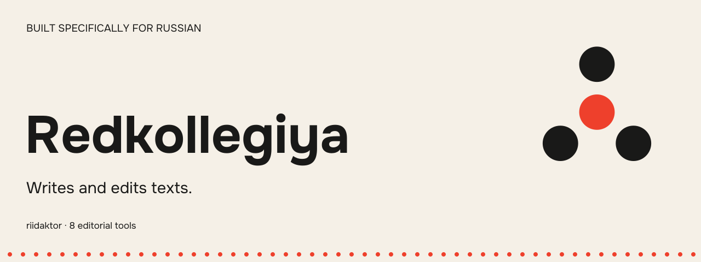
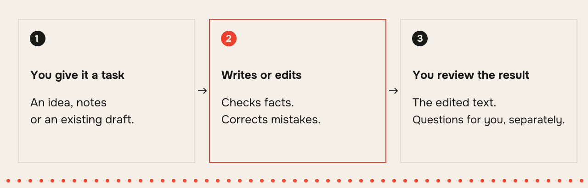
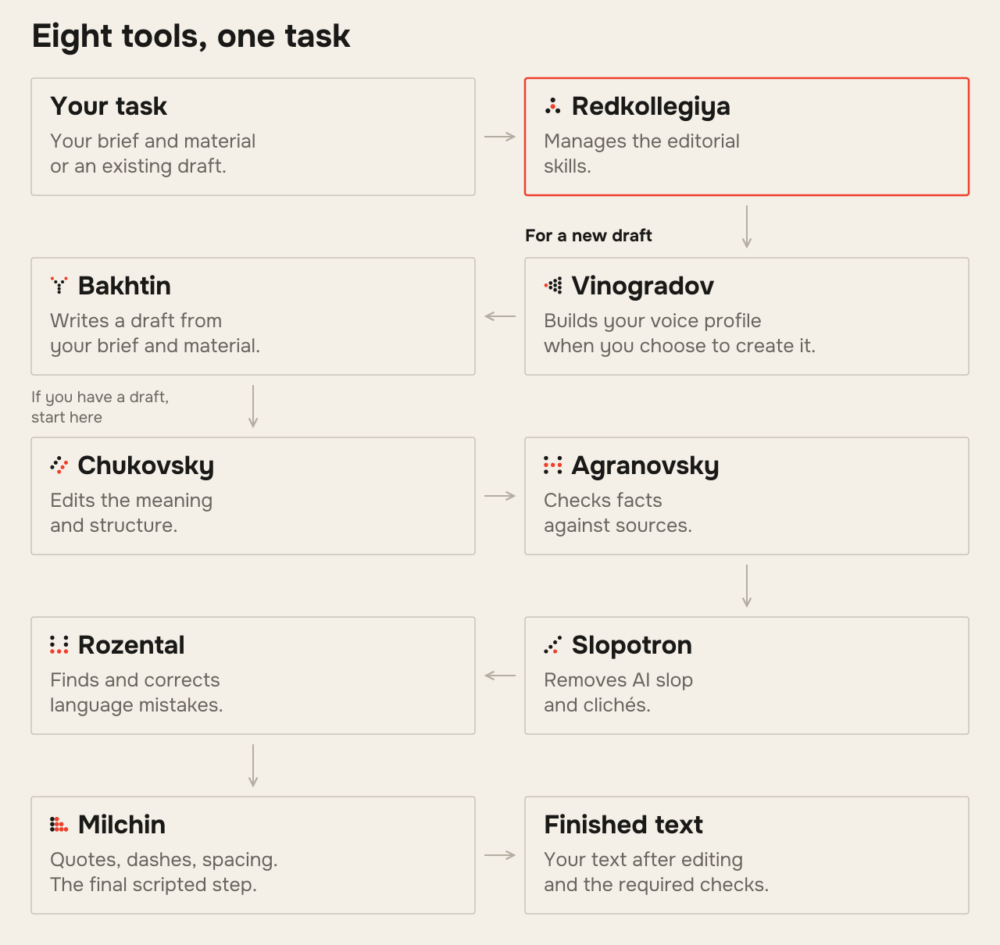

[Русский](README.md) · [English](README.en.md)

<picture>
  <source media="(prefers-color-scheme: dark)" srcset="assets/brand/cover-en-dark.svg">
  
</picture>

# Redkollegiya

**Built specifically for Russian.** Writes and edits texts. Give it an idea, notes or an existing draft and explain the result you need. Redkollegiya helps you write the text, clarify the argument, check facts and correct mistakes. It selects the tools for the job.

[How to install](#how-to-install) · [Example tasks](#example-tasks)

## How it works

Describe the task and attach notes, source material or an existing draft. Redkollegiya brings in the skills needed to write or edit the text, check facts and correct mistakes. You get the text, with questions and debatable passages that need your decision listed separately.


## Example tasks

### Write from notes

> Use Redkollegiya to write a Telegram post from these notes. The readers are first-time managers. Explain why one-to-one meetings matter and include three questions for a first meeting. Do not invent personal experience or facts.

Attach your notes or source links. The agent will ask for clarification if it needs more information to write the text.

### Improve a draft

> Edit this article with Redkollegiya. Make the argument clearer and remove repetition and bureaucratic phrasing. Keep my tone and examples. Show debatable changes separately.

### Check a text before publishing

> Check this text with Redkollegiya before publication: facts, logic and language mistakes. Provide sources for checked claims. Say clearly if something cannot be verified.

Describe the task in ordinary language. Say who the readers are, where the text will appear and what needs to be preserved. Attach the material the agent should use.

## How to install

### For agents

Claude Code, Codex / ChatGPT Desktop, Cursor, GitHub Copilot, Gemini CLI — give your agent this instruction:

```text
Install the Redkollegiya skill:
https://github.com/beaverbeard/redkollegiya

Use it whenever we write or edit texts.
```

<details>
<summary>More options</summary>

Agent-specific setup: [Claude Code](docs/OTHER-APPS.en.md#claude-code), [ChatGPT Desktop / Codex](docs/OTHER-APPS.en.md#codex), [Cursor](docs/OTHER-APPS.en.md#cursor), [GitHub Copilot](docs/OTHER-APPS.en.md#copilot), [Gemini CLI](docs/OTHER-APPS.en.md#gemini-cli).

### ChatGPT, Claude or Gemini in a browser

Download [this skill’s package](docs/downloads/redkollegiya.zip). It includes the instructions, scripts and resources.

- **ChatGPT:** create a project and add the instructions and resources from the extracted package. [Step by step](docs/OTHER-APPS.en.md#chatgpt).
- **Claude:** enable code execution and upload the ZIP in Customize → Skills. [Step by step](docs/OTHER-APPS.en.md#claude).
- **Gemini:** open Customize → Skills → Create → Upload and upload the package. [Step by step](docs/OTHER-APPS.en.md#gemini).

Available stages depend on the tools in your app. [Check readiness](docs/OTHER-APPS.en.md#readiness).

### Better still: the whole Redkollegiya toolkit

Install [Redkollegiya](https://github.com/beaverbeard/redkollegiya) with all eight skills. It selects the tools for writing, editing and proofreading. Give your agent this instruction:

```text
Install Redkollegiya and the complete set of eight editorial skills:
https://github.com/beaverbeard/redkollegiya

Use them whenever we write or edit texts.
```

</details>


## From task to text

<picture>
  <source media="(prefers-color-scheme: dark) and (max-width: 600px)" srcset="assets/brand/family-map-en-dark-narrow.svg">
  <source media="(prefers-color-scheme: dark)" srcset="assets/brand/family-map-en-dark.svg">
  <source media="(max-width: 600px)" srcset="assets/brand/family-map-en-light-narrow.svg">
  
</picture>

If you bring an idea and source material, Redkollegiya prepares a draft. If you bring an existing text, it edits it. Facts are checked in both cases. Missing sources and questions that need your decision are flagged separately.

## When your input is needed

An unverified fact, a missing example or a disputed phrase may need your input. Redkollegiya points out the passage and explains the question. Read the final text before publishing; replacing the original file requires your consent.

## Inside the toolkit

[Redkollegiya](https://github.com/beaverbeard/redkollegiya) combines writing, editing and checks into one workflow.

<picture>
  <source media="(prefers-color-scheme: dark) and (max-width: 600px)" srcset="assets/brand/system-map-en-dark-narrow.svg">
  <source media="(prefers-color-scheme: dark)" srcset="assets/brand/system-map-en-dark.svg">
  <source media="(max-width: 600px)" srcset="assets/brand/system-map-en-light-narrow.svg">
  
</picture>

These eight skills make up the writing toolkit. Below are their responsibilities and links to their repositories.

| Skill | What it helps you do |
|---|---|
| [Редколлегия / Redkollegiya](https://github.com/beaverbeard/redkollegiya) | Writes and edits texts, from the first draft through fact-checking and final proofreading. |
| [Виноградов / Vinogradov](https://github.com/beaverbeard/vinogradov) | Helps AI write in your style by analysing your texts and building an author voice profile. |
| [Бахтин / Bakhtin](https://github.com/beaverbeard/bakhtin) | Writes posts, emails and articles from your brief and material in the style you need. |
| [Чуковский / Chukovsky](https://github.com/beaverbeard/chukovsky) | Edits texts by improving structure, fixing gaps in logic and removing bureaucratic wording. |
| [Аграновский / Agranovsky](https://github.com/beaverbeard/agranovsky) | A fact-checking skill for texts. Checks numbers, dates, quotes and links, and shows sources. |
| [Слопотрон / Slopotron](https://github.com/beaverbeard/slopotron) | Clears out the AI slop and clichés everyone is sick of. |
| [Розенталь / Rozental](https://github.com/beaverbeard/rozental) | A proofreading skill: checks and corrects texts. Finds mistakes in spelling, punctuation and grammar. |
| [Мильчин / Milchin](https://github.com/beaverbeard/milchin) | A typography skill: formats text to Russian typesetting rules. Checks quotes, dashes and spacing. |

Proofreading order: Chukovsky → Agranovsky → Slopotron → Rozental → Milchin. Preparing an author voice profile and writing a new draft are added when the task calls for them.

## The riidaktor newsletter

In riidaktor, we explore how to write and edit texts with AI.

Learn to give clearer briefs, retain your own voice and spot invented details. Take the techniques into your workflow to spend less time reworking drafts and publish with more confidence.

[Subscribe to the newsletter →](https://redaktozavr.ru/rAIdactor?utm_source=skills)


## Compatibility and source

Setup depends on the app. The complete workflow needs source search, script execution and access to all eight skills.

The workflow instructions are in [SKILL.md](https://github.com/beaverbeard/redkollegiya/blob/fca4b440fe9a6aee712bd6a14a61a951b4a2d329/.claude/skills/redkollegiya/SKILL.md); [apply.py](https://github.com/beaverbeard/redkollegiya/blob/fca4b440fe9a6aee712bd6a14a61a951b4a2d329/.claude/skills/redkollegiya/apply.py) applies exact replacements. After changing the script, contributors should run `python3 apply.py --selftest`.

[MIT](https://github.com/beaverbeard/redkollegiya/blob/fca4b440fe9a6aee712bd6a14a61a951b4a2d329/LICENSE) · Rodion Scryabin / [beaverbeard](https://github.com/beaverbeard)
