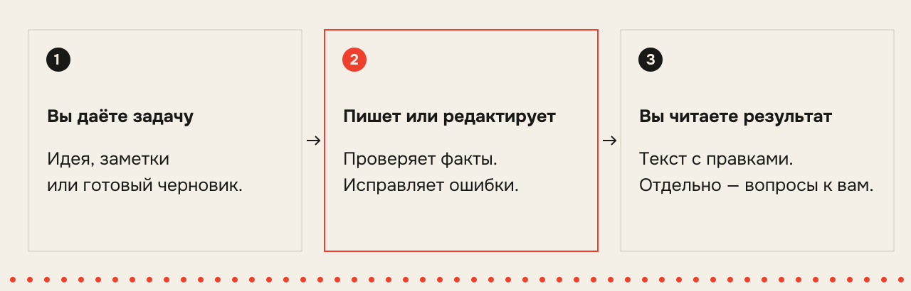
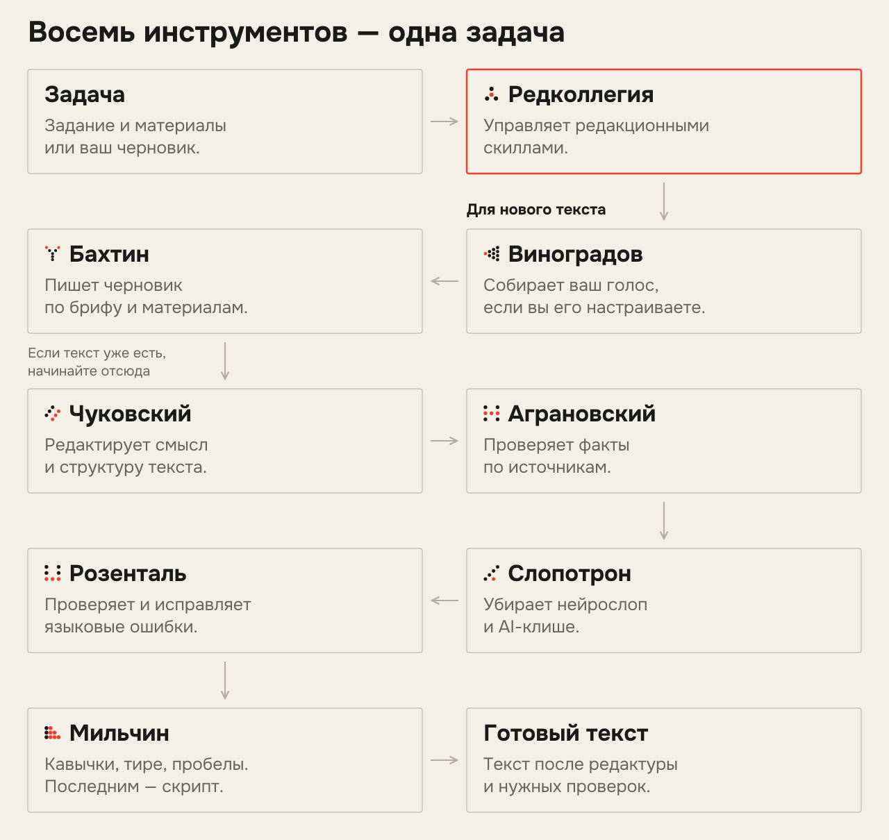

[Русский](README.md) · [English](README.en.md)

<picture>
  <source media="(prefers-color-scheme: dark)" srcset="assets/brand/cover-ru-dark.svg">
  
</picture>

# Редколлегия

**Специально для русского языка.** Пишет и редактирует тексты. Дайте идею, заметки или готовый черновик и расскажите, какой результат нужен. Редколлегия поможет написать текст, выстроить мысль, проверить факты и исправить ошибки. Нужные инструменты она подключает сама.

[Как установить?](#как-установить) · [Примеры задач](#примеры-задач)

## Как это работает

Вы описываете задачу и прикладываете заметки, материалы или готовый черновик. Редколлегия подключает нужные скиллы: они пишут или редактируют текст, проверяют факты и исправляют ошибки. Вы получаете текст, а отдельно — вопросы и спорные места, где нужно ваше решение.


## Примеры задач

### Написать текст по заметкам

> Используй Редколлегию. Напиши пост для Telegram по этим заметкам. Читатели — начинающие руководители. Объясни, зачем проводить встречи один на один, и добавь три вопроса для первой встречи. Не выдумывай личный опыт и факты.

Приложите заметки или ссылки на материалы. Если для текста чего-то не хватает, агент уточнит задачу.

### Улучшить черновик

> Отредактируй эту статью через Редколлегию. Сделай мысль яснее, убери повторы и канцелярит. Сохрани мою интонацию и примеры. Спорные изменения покажи отдельно.

### Проверить текст перед публикацией

> Проверь этот текст Редколлегией перед публикацией: факты, логику и языковые ошибки. К проверенным утверждениям дай источники. Если что-то нельзя подтвердить, скажи об этом прямо.

Задачу можно описывать обычными словами. Укажите, для кого и куда пишете, приложите материалы и скажите, что важно сохранить.

## Как установить?

### Для агентов

Claude Code, Codex / ChatGPT Desktop, Cursor, GitHub Copilot, Gemini CLI — отдайте агенту команду:

```text
Установи скилл «Редколлегия»:
https://github.com/beaverbeard/redkollegiya

Используй его, когда мы пишем или редактируем тексты.
```

<details>
<summary>Ещё варианты</summary>

Настройка для каждого агента: [Claude Code](docs/OTHER-APPS.ru.md#claude-code), [ChatGPT Desktop / Codex](docs/OTHER-APPS.ru.md#codex), [Cursor](docs/OTHER-APPS.ru.md#cursor), [GitHub Copilot](docs/OTHER-APPS.ru.md#copilot), [Gemini CLI](docs/OTHER-APPS.ru.md#gemini-cli).

### ChatGPT, Claude или Gemini в браузере

Скачайте [пакет этого скилла](docs/downloads/redkollegiya.zip). Внутри — инструкции, скрипты и ресурсы.

- **ChatGPT:** создайте проект и добавьте инструкции и ресурсы из распакованного пакета. [По шагам](docs/OTHER-APPS.ru.md#chatgpt).
- **Claude:** включите выполнение кода и загрузите ZIP в Customize → Skills. [По шагам](docs/OTHER-APPS.ru.md#claude).
- **Gemini:** откройте Customize → Skills → Create → Upload и загрузите пакет. [По шагам](docs/OTHER-APPS.ru.md#gemini).

Доступные этапы зависят от инструментов приложения. [Как проверить готовность](docs/OTHER-APPS.ru.md#readiness).

### А лучше — вся Редколлегия

Установите [Редколлегию](https://github.com/beaverbeard/redkollegiya) вместе со всеми восемью скиллами: она подключит нужные инструменты для написания, редактуры и вычитки текста. Отдайте агенту команду:

```text
Установи Редколлегию и весь комплект из восьми редакционных скиллов:
https://github.com/beaverbeard/redkollegiya

Используй их, когда мы пишем или редактируем тексты.
```

</details>


## От задачи к тексту

<picture>
  <source media="(prefers-color-scheme: dark) and (max-width: 600px)" srcset="assets/brand/family-map-ru-dark-narrow.svg">
  <source media="(prefers-color-scheme: dark)" srcset="assets/brand/family-map-ru-dark.svg">
  <source media="(max-width: 600px)" srcset="assets/brand/family-map-ru-light-narrow.svg">
  
</picture>

Если вы принесли идею и материалы, Редколлегия подготовит черновик. Если готовый текст — отредактирует его. Факты проверяются в обоих случаях. Места, где не хватает источника или нужно ваше решение, будут отмечены отдельно.

## Когда понадобится ваше решение

Неподтверждённый факт, недостающий пример или спорная формулировка могут потребовать вашего участия. Редколлегия покажет такие места и объяснит вопрос. Перед публикацией прочитайте итоговый текст; исходный файл заменяется с вашего согласия.

## Что внутри

[Редколлегия](https://github.com/beaverbeard/redkollegiya) соединяет написание, редактуру и проверку текста в один процесс.

<picture>
  <source media="(prefers-color-scheme: dark) and (max-width: 600px)" srcset="assets/brand/system-map-ru-dark-narrow.svg">
  <source media="(prefers-color-scheme: dark)" srcset="assets/brand/system-map-ru-dark.svg">
  <source media="(max-width: 600px)" srcset="assets/brand/system-map-ru-light-narrow.svg">
  
</picture>

Вся система состоит из восьми скиллов. Ниже — задачи каждого и ссылки на их репозитории.

| Скилл | Чем поможет |
|---|---|
| [Редколлегия / Redkollegiya](https://github.com/beaverbeard/redkollegiya) | Пишет и редактирует тексты. Помогает пройти путь от первого черновика до проверки фактов и финальной вычитки. |
| [Виноградов / Vinogradov](https://github.com/beaverbeard/vinogradov) | Помогает ИИ писать в вашем стиле: изучает ваши тексты и собирает профиль авторского голоса. |
| [Бахтин / Bakhtin](https://github.com/beaverbeard/bakhtin) | Пишет посты, письма и статьи по вашему брифу и материалам, учитывая нужный стиль. |
| [Чуковский / Chukovsky](https://github.com/beaverbeard/chukovsky) | Редактирует тексты. Выстраивает мысль, исправляет провалы в логике и убирает канцелярит. |
| [Аграновский / Agranovsky](https://github.com/beaverbeard/agranovsky) | Скилл-фактчекер для текстов. Проверяет цифры, даты, цитаты и ссылки, показывает источники. |
| [Слопотрон / Slopotron](https://github.com/beaverbeard/slopotron) | Очищает тексты от нейрослопа и AI-клише, которые всех бесят. |
| [Розенталь / Rozental](https://github.com/beaverbeard/rozental) | Скилл-корректор: проверяет и исправляет тексты. Находит ошибки в орфографии, пунктуации и грамматике. |
| [Мильчин / Milchin](https://github.com/beaverbeard/milchin) | Скилл-типограф: приводит текст к нормам русской типографики. Проверяет и исправляет кавычки, тире и пробелы. |

Порядок вычитки: Чуковский → Аграновский → Слопотрон → Розенталь → Мильчин. Подготовка авторского голоса и написание нового текста подключаются, когда нужны по задаче.

## Рассылка «рИИдактор»

В «рИИдакторе» мы разбираем, как писать и редактировать тексты с ИИ.

Учимся давать понятные задания, сохранять свой голос и замечать то, что нейросеть придумала за вас. Берите приёмы в работу, чтобы тратить меньше времени на переделки и увереннее выпускать тексты.

[Подписаться на рассылку →](https://redaktozavr.ru/rAIdactor?utm_source=skills)


## Совместимость и исходники

Способ подключения зависит от приложения. Для полного процесса нужны поиск по источникам, выполнение скриптов и доступ ко всем восьми скиллам.

Инструкции работы — в [SKILL.md](https://github.com/beaverbeard/redkollegiya/blob/fca4b440fe9a6aee712bd6a14a61a951b4a2d329/.claude/skills/redkollegiya/SKILL.md), точные замены вносит [apply.py](https://github.com/beaverbeard/redkollegiya/blob/fca4b440fe9a6aee712bd6a14a61a951b4a2d329/.claude/skills/redkollegiya/apply.py). После изменения скрипта разработчику нужно запустить `python3 apply.py --selftest`.

[MIT](https://github.com/beaverbeard/redkollegiya/blob/fca4b440fe9a6aee712bd6a14a61a951b4a2d329/LICENSE) · Родион Скрябин / [beaverbeard](https://github.com/beaverbeard)
